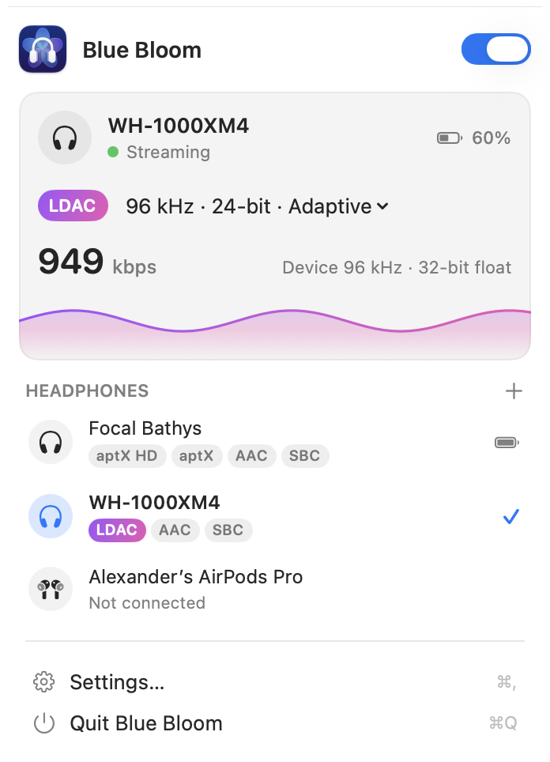

<p align="center">
  
</p>

<h1 align="center">Blue Bloom</h1>

<p align="center">High-quality Bluetooth audio for your Mac</p>

<p align="center"><b>English</b> · <a href="README.zh-Hans.md">简体中文</a></p>

Blue Bloom is a menu bar app that streams your Mac's audio to Bluetooth headphones with the best codec they support: **LDAC, aptX HD, aptX, AAC or SBC**. On its own, macOS only uses AAC or SBC.

<p align="center">
  <picture>
    <source media="(prefers-color-scheme: dark)" srcset="docs/images/panel-dark.png">
    
  </picture>
</p>

## Features

- **Better codecs**: LDAC up to 96 kHz / 24-bit (330, 660 or 990 kbps), aptX HD (24-bit), aptX, AAC up to 320 kbps, and SBC including SBC XQ (dual channel, about 500 kbps).
- **Adaptive bitrate**: when the Bluetooth link gets congested, LDAC, SBC and AAC step down and come back up once it clears.
- **Sample rate that follows your music**: while Apple Music plays, Blue Bloom aims for the track's sample rate (within what the codec supports); otherwise it follows the output device.
- **Volume and buttons**: the Mac volume drives the headphones' own amplifier (AVRCP absolute volume), and the headphones' play, pause and skip buttons control the Mac.
- **Battery level** of the headphones in the menu.
- **Automatic mode**: Blue Bloom takes over only when the headphones support a better codec than macOS (LDAC or aptX). Otherwise macOS keeps them.
- Available in English, Simplified Chinese, Traditional Chinese, Japanese, Korean, German, French and Spanish.

## Requirements

- A Mac with Apple silicon or an Intel processor, running macOS 14.2 or later.
- Tested on macOS 27 with Apple silicon, and briefly on macOS 26 on an Intel machine. On other versions Blue Bloom asks before it takes over your headphones.

## How it works

- Blue Bloom talks to the macOS Bluetooth daemon directly and opens the A2DP channels to your headphones itself, so it can choose the codec and bitrate. It also holds the hands-free and remote control channels, so macOS doesn't switch the headphones to call mode and the volume and buttons go through Blue Bloom.
- It adds a virtual audio device named **Blue Bloom**. Audio that apps play to it is encoded and streamed to the headphones.
- When you quit Blue Bloom or turn it off, the headphones go back to macOS.

## Limitations

- While Blue Bloom is connected, other apps can't use the headphones' microphone, including calls, dictation and recording.
- Blue Bloom relies on private macOS interfaces, so a macOS update can break it. If that happens, turn Blue Bloom off or quit it.

## Install

### Download

1. Download `BlueBloom-<version>.dmg` from [Releases](https://github.com/jonathanlu98/bluebloom/releases), open it and drag Blue Bloom to Applications.
2. Open Blue Bloom. It isn't signed with an Apple Developer ID yet, so macOS blocks it the first time: go to **System Settings › Privacy & Security** and click **Open Anyway**.
3. Allow Bluetooth access, read the first-run notice, and install the Blue Bloom audio device when asked. This needs an administrator password once.

After each update macOS asks for Bluetooth access again, because the app isn't signed with a Developer ID yet.

### Build from source

You need Xcode 26 or later and [Bazelisk](https://github.com/bazelbuild/bazelisk) (`brew install bazelisk`).

```sh
git clone https://github.com/jonathanlu98/bluebloom.git
cd bluebloom
tools/install-app.sh
```

`install-app.sh` builds the app, installs it to `/Applications` (replacing any copy there) and opens it.

## Usage

- Click the Blue Bloom icon in the menu bar to turn it on or off, pick headphones, and change the codec or quality from the streaming card.
- **Settings** has General, Codecs, Audio, Devices, Advanced and About.
- To remove everything, use **Settings › Advanced › Uninstall Blue Bloom…**. It removes the audio device, the login item, settings and log, then moves the app to the Trash.

## Reporting problems

The developer doesn't have most headphones, so logs are what make a problem fixable.

1. Right after the problem happens, open **Settings › About › Export Diagnostics…**. It saves `BlueBloom-Diagnostics-<date>.zip` to your Desktop with Blue Bloom's logs and the last two hours of the macOS Bluetooth log. Bluetooth addresses are masked; device names are included.
2. [Open an issue](https://github.com/jonathanlu98/bluebloom/issues/new/choose) with the **Bug report** form and attach the zip. The form also asks for the summary from **Copy Diagnostics**.

Headphones that haven't been tested yet are very welcome: the **Headphones report** form collects how Blue Bloom works with yours, good or bad. You can write in English or Chinese.

## Development

```sh
bazel build //App:BlueBloom //CLI:bluebloom
bazel run //tools/codectest:sbc_roundtrip    # also aac_roundtrip, ldac_roundtrip
```

The command-line tool `bluebloom` is mainly for development:

```sh
bazel-bin/CLI/bluebloom list                 # paired devices
bazel-bin/CLI/bluebloom probe "<name>"       # codecs the headphones declare
bazel-bin/CLI/bluebloom codectest            # encode a test tone with every codec, no headphones needed
```

UI text is localized with String Catalogs. After changing it, run `zsh tools/i18n/update-strings.sh`, add translations to `tools/i18n/translations/<language>.json`, then run `python3 tools/i18n/apply-translations.py`.

## License

Blue Bloom is released under the [MIT License](LICENSE). It includes third-party code under its own licenses (Apache 2.0 and LGPL 2.1); see [`third_party/README.md`](third_party/README.md). The app shows the full notices in **Settings › About**.

LDAC is a trademark of Sony Corporation. aptX is a trademark of Qualcomm Technologies, Inc. Bluetooth is a registered trademark of Bluetooth SIG, Inc. Other names are trademarks of their respective owners. Blue Bloom is not affiliated with, endorsed by or certified by any of them, and is provided as is, without warranty.
